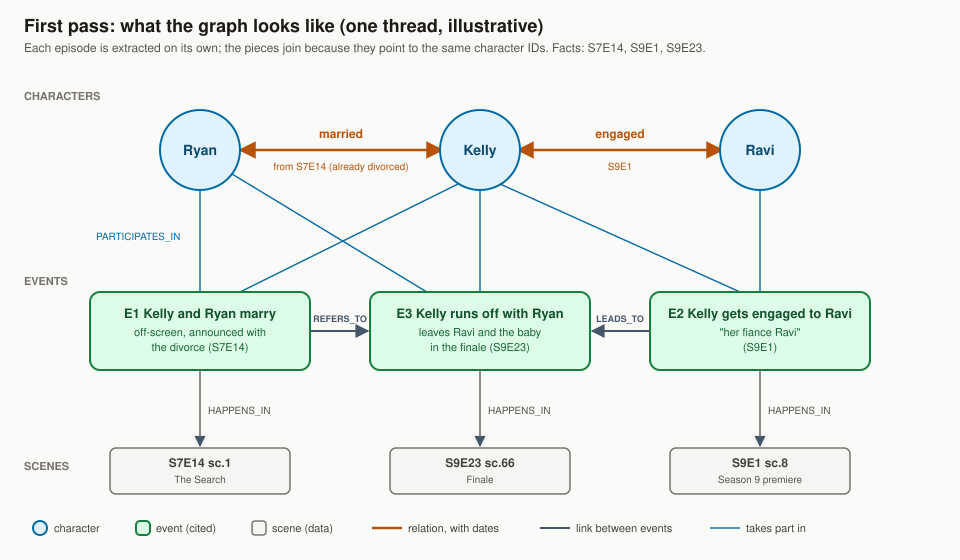

# Graph design (Phase 3 draft)

Status: **design note only.** Phase 3 is built only if Phase 2 findings show multi-hop or whole-dataset
questions still fail. Target questions: "What are the major storylines of Season 5?", "Trace every relationship
Andy had and what happened to each partner."

## Core idea
A relationship-only graph (who married whom) is weak; single facts are answered by plain retrieval. Narrative
questions need **events** as nodes: storylines are chains of events across episodes.

## Nodes
| Node | Examples | Source |
|---|---|---|
| Character (+ aliases) | Jim ("Big Tuna", "Halpert") | speaker names, mentions in dialogue |
| Episode, Scene | S5E1 Weight Loss, scene 12 | data (no LLM) |
| Event | Jim proposes to Pam at a gas station | LLM extraction, cited to a scene |
| Storyline | Michael Scott Paper Company, Jim & Pam | grouped from events |
| Place (incl. company sites) | the office, the warehouse, Jim's house, Dunder Mifflin Scranton | LLM extraction, local per episode, linked like characters |

## Edges
| Edge | Kind |
|---|---|
| Scene PART_OF Episode, Episode NEXT Episode | structural (data) |
| Character APPEARS_IN Scene, Character TALKS_TO Character {scenes} | computed (SQL) |
| Character PARTICIPATES_IN Event {role}, Event HAPPENS_IN Scene | extracted, cited |
| Event LEADS_TO Event | extracted (cause and effect; links storylines together) |
| Event PART_OF Storyline | grouped |
| Character RELATION {dating, married, boss, rival, family} Character {from_ep, to_ep} | extracted, timed |
| Character WORKS_AT Organization {from_ep, to_ep} | extracted, timed |

## Rules
1. Fixed list of node and edge types; no open-ended extraction.
2. Every extracted fact has a scene citation and an episode index (time).
3. Structural and computed edges form a reliable base; only the event layer depends on the LLM.

## Linking (two stages)
**Stage 1, per episode:** the LLM lists the characters it sees in that episode as local characters (names as written, a
description of at most 15 words, present or only mentioned) and writes events and relations against those local ids.
It is never asked who they are elsewhere in the series.

**Stage 2, across the series (separate, re-runnable, does not repeat stage 1):**
1. Build a card per local character: names, description, episode, lines spoken, who they appear with.
2. Group cards by name (all the "David" cards, one card per episode where a David appears, about 40 cards).
3. Decide with signals from the data first: two different local characters in one episode, or two who speak to each
   other, are different people; same name with the same colleagues in nearby seasons is probably the same person;
   incompatible full names are different people. Main-cast labels (all signals agree) merge by code with no LLM.
4. For groups the signals cannot settle, one LLM call per group sees the cards and partitions them into people, citing
   line ids and giving a confidence. Unsure means stay separate (a wrong merge puts facts on the wrong person).
5. Mentioned-only cards are linked after the speaking cards, to a resolved person whose name matches and who is active
   then; if two fit, the mention stays `ambiguous` and its facts are low-confidence.
6. Generic labels (Man, Guy, Waiter, Girl) are never merged across episodes.
   Places are linked the same way (cards with names, descriptions and the events that happen there): "the office" in
   many episodes becomes one place; "Jim's house" or "the conference room" are linked only when the evidence agrees.
7. Result: `episode_character(episode, local_id, entity_id, method rule | llm | owner, confidence, reason)`. After merging,
   checks run (no entity with two cards in one episode, no two overlapping marriages); a violation undoes the merge and
   flags it. Rerunning stage 2 never calls stage 1.
   One review run per episode after stage 1 (a second run would recover some misses but doubles the review cost; not used).

Other links: events across episodes (REFERS_TO / LEADS_TO) come from candidate search plus a rule or a short LLM call
(see the refers_back pointers); storylines: community detection on the event-character graph, later.

Extraction runs per episode (186 calls), not per scene: 35% of scenes are a single line.

## Answering "major storylines of Season 5"
Storylines with events in Season 5, ranked by number of events and episodes covered, answered from their
summaries with key event scenes as citations.

## Baseline to beat
Hierarchical summaries (episode → season, RAPTOR-style) without a graph. Research question: does the event graph
beat hierarchical summaries on storyline questions, and is the extra cost worth it?

## First pass, pictured

One thread (Kelly, Ryan, Ravi) from S7E14, S9E1 and S9E23: characters from the registry, LLM-extracted events and timed
relations, each event tied to its scenes. Episodes are extracted separately and join through shared character IDs.

## Quality at scale (how production knowledge-graph pipelines do it)
No hand-checking of facts. Every step is mechanical, and the LLM is checked by code or by a second pass:
1. **Evidence-grounded extraction:** every event and relation must carry the quoted line(s) that support it and the
   scene numbers. Code checks that the quote exists in that scene (string match); facts that fail are rejected.
2. **Schema and registry validation:** structured JSON output against a schema; relation types from the fixed list;
   character, organization and place IDs must exist in the registry. Unknown names go to a review queue, never
   become silent duplicates.
3. **Self-consistency:** extract each episode twice (or with two models); keep facts both runs agree on, and send
   disagreements to a verifier call that sees only the cited scene and must confirm or reject. Each fact gets a
   confidence from agreement.
4. **Entity resolution with a canonical registry:** speaker list plus aliases; candidate duplicates found by name
   similarity and flagged by SQL checks (near-identical names, characters with almost no scenes).
5. **Measured quality, not spot-checks:** precision from a random stratified sample audited by a separate verifier
   (reported with a confidence interval); recall against an answer key we already have (owner lists such as the
   "That's what she said" list, the reference questions).
6. **Idempotent, versioned pipeline:** deterministic IDs (episode, scene, normalised text hash), extraction version
   and model recorded on every row, failed episodes retried individually, reruns replace rather than duplicate.
7. **Whole graph from Claude:** one agent per episode (subscription, like the grading council) writes a JSON file;
   a validator and loader apply steps 1, 2 and 6 and load Postgres. No LLM call is made without the owner's yes.

## Preprocessing and code decisions (record of every non-LLM step)
Everything the code does around the LLM calls, with where it lives. Decisions are dated in findings/decisions.md.

**Before stage 1 (graph/extract_one.py)**
- Episode text is rebuilt from the `lines` table: a header (`Episode: S7E14 "title"`), the speaker labels used with line
  counts (a data hint, not identities), then scene by scene `[L<line id>] Speaker: text` (stage directions stay inside the
  text in brackets). Evidence is cited by line id, so scene numbers are derived by code.
- The model gets the system prompt `generation/prompts/extract_v1.md` and the response schema `graph/stage1_schema.json`
  (no `maxItems`: Gemini rejects it; size limits are validator flags). Thinking `low`, max output 16,384.

**After stage 1 (graph/validate.py, lenient, no retry)**
- Hard (drop the row or reference): line id not in the episode, local id undefined or duplicated, relation between a person and
  themselves, value outside its list, nothing valid left to cite. Flag (keep): relation quote not found in the cited lines
  (marked unverified), name not in the episode, participant not named in the cited lines, unknown place, over-long or duplicate
  event, too many events. Episode status ok / flagged / failed.

**Review pass (graph/review.py, prompt generation/prompts/review_v1.md)**
- Relations get ids r1, r2, ... (stage 1 has none); validator flags are removed from what the reviewer sees.
- **Hint words:** per item, the words of the model's own free text (character descriptions, place names and descriptions,
  event sentences, relation details; not ids, names, quotes or line numbers) that occur nowhere in the episode text.
  Steps: (1) the episode vocabulary = every word of every line and speaker label, reduced to a rough stem by `_stem`
  (strips ing, ed, es, s, ly; hand-written, leaves artifacts such as tri / fami); (2) the item's words go through the same
  stem; (3) drop words in `STOP` (about 150 hand-written common English words) and words of 2 letters or fewer;
  (4) a word also counts as seen if it starts like, or is a start of, a vocabulary word of 4+ letters; (5) the rest are the
  hints. Hints are pointers only: the reviewer decides, items without hints are still checked, derived words are fine.
- **Evidence beside each item:** the review input also contains, per item, the text of the lines it cites (`evidence_block`), and
  the prompt says a claim is supported only if a line says or shows it about that person, place or event (a plausible guess is
  not support). Stage 1 descriptions must start with a verb and name no job, rank or department unless a line says it.
- The reviewer returns `checked` (every item id) and `corrections` (edit / set / drop on an item or field, by id). Allowed
  fields: character description; place description and kind; event text, certainty, place, importance, kind, one participant
  (drop); relation certainty and detail; drop of an item. Anything else is skipped and logged. Code applies the corrections to
  a copy, runs the validator again, and keeps both versions plus a log (old value, new value, reason).
- **Edit guard:** an `edit` may only delete or reorder. Every content word of the new text must already be in the old text or in
  the episode vocabulary; words that are in neither are taken out again (and a leading who / that left behind). It stops the
  corrector acting as a writer (it replaced job titles with "Employee" in 6 descriptions in the third S2E18 run). Replay of the
  saved corrections: 14 of 14 applied, the 6 "Employee" substitutions repaired.
- Hint usefulness is measured after the fact from the log: a hint word removed by a correction was useful, a hint word left
  untouched was noise, a correction on an unhinted word was missed by the list. Words that are often hinted and never
  corrected could later go on an ignore list learned from these decisions.

**Planned (stage 2, not built)**
- Cards per local character and place, grouped by name; data signals first (same episode = different people, speaking to
  each other = different people, main-cast labels by code); LLM only for groups the signals cannot settle; unsure = separate;
  generic labels (Man, Guy, Waiter) never merged across episodes; the result lands in `episode_character`.
- Relation timelines are built from evidence rows by a small state machine (begins opens an interval, revealed opens one with an
  unknown start, ends closes it), with checks after merging (no two overlapping marriages, no end before start).

**Rule for the graph builder:** the validator finding `participant_not_in_lines` is informational (a participant who is present but
not named in the cited lines; in the quality sample it never pointed to a wrong event). Only `unverified_quote`, `no_quote` and
`too_many_major` mean "look at this". Newer runs record it with severity `info`; the stored run v3-extract-001 has it as `flag` and
is not re-derived.

## Character linking as built (graph/link_certain.py, no LLM): only what the data proves
**Rule (owner decision 2026-10-10): link only what we can say with certainty; the rest stays unlinked.** A character entity exists when
a primary name (first name on the card) recurs in 40+ episodes with one card per episode; a name that recurs that often cannot be a
one-off collision of different people. Smaller groups attach only on strong evidence (the entity's cards list the name on 2+
cards and the two never appear together in an episode); on run v3-extract-001 that attached creed bratton and meredith palmer.
Everything else is an unlinked, episode-local node (name, description, episode), still found through event text, the v2 search
and name-string lookups. Name tests (surname conflicts) were dropped for certainty: they rejected Pam and Phyllis (maiden and
married names) and missed a one-card "Robert Lipton" inside the 19-card "robert" group (Robert California and the senator are
two people), so groups like robert, david, bob, todd packer, holly, nellie, karen stay unlinked.

Result: **20 certain entities** (jim, dwight, pam, kevin, angela, phyllis, stanley, oscar, andy, meredith, ryan, kelly, creed, michael,
toby, darryl, erin, jan, gabe, roy), 2,766 of 3,883 cards (71%). Coverage of what we extracted: 99% of events have at least one
certain participant, 76% have two or more different ones; 137 of 325 relations (42%) have both ends certain, 152 have one end
certain (the other end is an unlinked local node, found by name). **Known limitation (accepted):** recurring minor characters
(David Wallace, Holly, Nellie, Karen, Robert California, the senator, Bob Vance, ...) are not entities; questions about them are
answered from event text and the v2 search, not from graph identity. Exploratory tools: graph/link_characters.py (evidence
analysis), graph/link_analysis.py.

